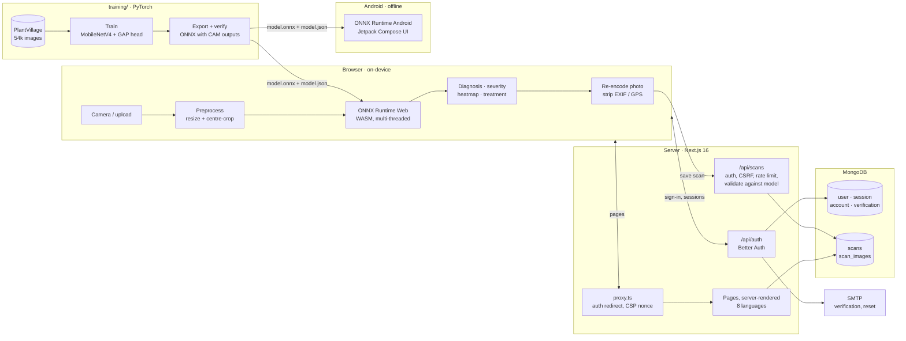

# PlantGuard

**Crop disease detection that shows its work.** Photograph a leaf and PlantGuard
identifies one of **38 conditions across 14 crops** in about a second,
estimates how far the infection has spread, highlights the exact regions of the
leaf that drove the decision, and suggests what to do next, in English or seven
Indian languages.

The disease model runs **on the device**, in the browser or on an Android
phone, so a photo is analysed without being uploaded. The web app adds
accounts and a private scan history, so farmers can track problems across
fields and seasons.

| | |
| --- | --- |
| **Web app** (`pc/`) | Next.js 16, React 19, MongoDB, Better Auth, ONNX Runtime Web. Accounts, history, dashboard, admin console, 8 languages. |
| **Android app** (`mobile/`) | Kotlin, Jetpack Compose, ONNX Runtime Android. Fully offline. Min SDK 26. |
| **Model** (`training/`) | PyTorch + timm, `mobilenetv4_conv_small`. 96.96% test accuracy, 9.7 MB ONNX. |
| **Contracts** (`docs/`) | The model interface and design system that both apps implement. |

```
training/   PyTorch pipeline -> ONNX model + manifest, published to both apps
pc/         Next.js web app   (accounts, scan history, on-device inference)
mobile/     Android app       (offline, on-device inference)
docs/       MODEL_CONTRACT.md, DESIGN_SYSTEM.md
```

## Architecture



The model is trained once and exported with its class-activation maps built
into the graph. Both apps run that same file locally, so a photo is diagnosed
without leaving the device. The web server only handles accounts and the scans
a user chooses to save.

---

## Contents

- [Architecture](#architecture)
- [What it does](#what-it-does)
- [Supported crops and conditions](#supported-crops-and-conditions)
- [Quick start](#quick-start)
- [Web app](#web-app)
- [Configuration](#configuration)
- [Deployment](#deployment)
- [How the heatmap works](#how-the-heatmap-works)
- [The model](#the-model)
- [Android app](#android-app)
- [Security and privacy](#security-and-privacy)
- [Testing and CI](#testing-and-ci)
- [Known limitations](#known-limitations)
- [Before launch](#before-launch)
- [Repository notes](#repository-notes)

---

## What it does

1. **Scan.** Take a photo, pick one from the gallery, drag in several at once,
   or paste one from the clipboard.
2. **Diagnose.** The model names the most likely condition with a confidence
   figure and lists the runners-up. When the model is unsure it says so, and
   asks for a clearer photo, rather than presenting a guess as a diagnosis.
3. **See the evidence.** A heatmap shows which parts of the leaf produced the
   result, overlaid on the photo or side by side. Selecting a runner-up shows
   *that* condition's evidence.
4. **Gauge severity.** From mild to critical, with the full distribution
   across levels.
5. **Act.** Treatment and prevention advice matched to the disease and its
   severity.
6. **Keep a record** (web). Scans save automatically to a private history
   with the photo, heatmap, field or plot name, and notes. Search, filter,
   export to CSV, and track trends on the dashboard.

## Supported crops and conditions

38 classes across 14 crops, including a *healthy* class for most crops:

| Crop | Conditions |
| --- | --- |
| Apple | Apple scab, Black rot, Cedar apple rust, Healthy |
| Blueberry | Healthy |
| Cherry | Powdery mildew, Healthy |
| Corn (maize) | Gray leaf spot, Common rust, Northern leaf blight, Healthy |
| Grape | Black rot, Esca (black measles), Leaf blight, Healthy |
| Orange | Citrus greening (HLB) |
| Peach | Bacterial spot, Healthy |
| Bell pepper | Bacterial spot, Healthy |
| Potato | Early blight, Late blight, Healthy |
| Raspberry | Healthy |
| Soybean | Healthy |
| Squash | Powdery mildew |
| Strawberry | Leaf scorch, Healthy |
| Tomato | Bacterial spot, Early blight, Late blight, Leaf mold, Septoria leaf spot, Spider mites, Target spot, Yellow leaf curl virus, Mosaic virus, Healthy |

## Quick start

The trained model is committed (`pc/public/models/` and
`mobile/app/src/main/assets/`, one identical file), so neither app needs a GPU,
the 2 GB dataset or a training run to start.

### Android app: install the APK

1. On your phone, download **PlantGuard-v1.0.apk** from the
   [latest release](https://github.com/nakultt/crop-disease-detection/releases/latest)
   (it is also committed at [`releases/PlantGuard-v1.0.apk`](releases/PlantGuard-v1.0.apk)).
2. Open it. Android asks once to allow installs from your browser or file
   manager; allow it, then tap **Install**.
3. Open PlantGuard, tap **Gallery** or **Camera**, and pick a leaf.

The app works fully offline. It needs Android 8.0 or newer on an ARM phone
(every mainstream phone). If an older debug build is already installed, uninstall
it first: the release is signed with a different key.

To build it yourself instead, open `mobile/` in Android Studio and press Run, or:

```bash
cd mobile && ./gradlew installDebug
```

### Web app: run it on your computer

**1. Install the prerequisites (once)**

- **Node.js 20.9 or newer**: <https://nodejs.org> (the LTS installer).
- **MongoDB Community Server**: <https://www.mongodb.com/try/download/community>.
  On Windows, keep the installer's default *Install MongoD as a Service*; it
  then starts with Windows on `127.0.0.1:27017`, which is all the app needs.
  Or, with Docker: `docker run -d --name plantguard-mongo -p 27017:27017 mongo:8`.

**2. Install and start the app**

```bash
cd pc
npm install
npm run dev
```

Open <http://localhost:3000>. There is no `.env` file or other setup: the app
creates its own session secret in `pc/.data/`.

**3. Use it**

1. Click **Get started**, create an account (email verification is off by
   default), and you land on the dashboard.
2. Open **Scan Crop**, upload a leaf photo, and the diagnosis, heatmap,
   severity and treatment appear in about a second. The scan is saved to
   **History**.
3. Ready-made test photos are in [`demo-images/`](demo-images): 20 leaves,
   each named after the result the app gives for it.

**Run the production build** (faster, what you would deploy):

```bash
cd pc
npm run build
npm start                      # http://localhost:3000
```

**Everything in Docker** (app + MongoDB + Mailpit, still no configuration):

```bash
cd pc
docker compose up -d --build      # app :3000, caught emails :8025
```

**Extras**

- Password-reset emails are printed to the server log when no SMTP server is
  configured.
- Make yourself an admin: `npm run admin:grant -- you@example.com`.
- Port 3000 taken? `npm run dev -- --port 3001`.

**Troubleshooting**

| Symptom | Fix |
| --- | --- |
| `MongoServerSelectionError` / `ECONNREFUSED 127.0.0.1:27017` | MongoDB isn't running. Windows: start the *MongoDB* service in `services.msc`. Docker: `docker start plantguard-mongo`. |
| "Preparing the model" never finishes | Hard-refresh the page (Ctrl+F5). The 9.7 MB model downloads once and is cached. |
| `npm install` fails | Check `node -v` is 20.9 or newer. |
| `npm start` says no standalone build | Run `npm run build` first. |

### Train your own model

```bash
cd training
uv sync
uv run python main.py download          # PlantVillage from Kaggle (~2 GB)
uv run python main.py train             # two-phase, ~38 s/epoch on an RTX 4060
uv run python main.py evaluate          # metrics, confusion matrices, CAM samples
uv run python main.py export --verify   # ONNX + manifest, published to both apps
```

`uv run python main.py info` shows what exists on disk and what to run next.
`main.py export --demo` publishes an untrained model flagged `trained: false`;
both apps then show a prominent "predictions are not meaningful" banner.

---

## Web app

### Features

- **Accounts:** email and password with email verification, password reset,
  and confirmation for email changes. Optional Google and GitHub sign-in.
  Settings list active sessions, with sign-out everywhere, and let users
  delete their account along with all their data. Sign-in is required for the
  app pages; signed-out visitors see the landing, crops, about, privacy and
  terms pages.
- **Scanner:** multiple photos at once, camera capture, and clipboard paste.
  Shows model download progress, and saves automatically (can be turned off
  in settings).
- **History:** search by field name, notes or disease, and filter by crop,
  health and severity. The URL keeps the filters, so a view can be bookmarked.
  Paginated. Exports the current view to CSV.
- **Scan detail:** the saved photo and heatmap, the runners-up with their own
  heatmaps, severity, treatment, editable notes, photo download, and delete.
- **Dashboard:** totals, a weekly activity chart (with a table view), the
  severity mix, crops scanned, and the most common problems.
- **Settings:** profile, email change, scan preferences (auto-save, keep
  photos), theme, language, password, sessions, data export (JSON), clear
  history, and delete account.
- **Admin console:** user search, roles, bans, sign-ups and scans per day, and
  the most common conditions platform-wide.
- **Languages:** English, Tamil, Hindi, Telugu, Kannada, Malayalam, Marathi
  and Bengali. Pages are rendered on the server in the visitor's language,
  taken from their saved choice or their browser's preference. A test fails
  the build if any screen is left untranslated.
- **Themes and accessibility:** light, dark and system themes. Full keyboard
  navigation with visible focus rings, and reduced motion honoured. Severity
  is always shown as a label as well as a colour. Charts have table views,
  and the heatmap describes the highlighted region in words.
- **Installable:** web app manifest, icons, Open Graph image, robots.txt and
  sitemap.

### Architecture

```
browser                                  server (Next.js)                    MongoDB
───────                                  ────────────────                    ───────
model.onnx ─▶ ONNX Runtime (WASM) ─▶ diagnosis + CAM cube
                     │
photo ─▶ re-encode (strips EXIF/GPS) ─▶ POST /api/scans ─▶ validate against ─▶ scans
                                        (auth, CSRF,       the model manifest  scan_images
                                         rate limit,
                                         size + type)
sign-in, sessions ◀───────────────────▶ /api/auth/* (Better Auth) ──────────▶ user, session,
                                                                            account, …
```

| Path | Role |
| --- | --- |
| `pc/src/proxy.ts` | Redirects signed-out visitors; sets the per-request CSP nonce |
| `pc/src/server/env.ts` | Validated configuration (fails fast in production) |
| `pc/src/server/auth.ts` | Better Auth: providers, emails, admin plugin, account deletion |
| `pc/src/server/db.ts` | MongoDB client and indexes |
| `pc/src/server/scans.ts` | Scan store, validation against the model, dashboard stats |
| `pc/src/app/api/` | Scans, images, CSV and JSON export, account, health |
| `pc/src/app/lib/inference.ts` | ONNX Runtime session, preprocessing, `predict()` |
| `pc/src/app/lib/cam.ts` | CAM normalise, bilinear upscale, colormaps |
| `pc/src/app/lib/i18n/` | Language negotiation, typed dictionaries, `t()` |
| `pc/e2e/` | Playwright end-to-end tests |

### API

All endpoints require a session, except health and auth. Every mutating
request is also origin-checked.

| Method and path | Purpose |
| --- | --- |
| `GET /api/scans` | List the user's scans (search, filters, pagination) |
| `POST /api/scans` | Save a scan (multipart: metadata, CAM data, photo, thumbnail) |
| `GET/PATCH/DELETE /api/scans/:id` | Read, edit notes or label, delete |
| `GET /api/scans/:id/image` | The saved photo (`?variant=thumb`, `&download=1`) |
| `GET /api/scans/export` | CSV of the filtered history |
| `GET /api/account/export` | Everything about the account, as JSON |
| `DELETE /api/account/scans` | Delete every saved scan |
| `/api/auth/*` | Sign-up, sign-in, sessions, verification, reset (Better Auth) |
| `GET /api/health` | 200 when the database and model are ready, else 503 |

## Configuration

Every setting is documented in [`pc/.env.example`](pc/.env.example). The
important ones:

| Variable | Purpose |
| --- | --- |
| `APP_URL` | Public URL, used for email links, OAuth callbacks and origin checks. Default `http://localhost:3000`. |
| `BETTER_AUTH_SECRET` | 32+ random characters that sign sessions. Generated and saved to `.data/` if unset. |
| `MONGODB_URI` | MongoDB connection string. Default `mongodb://127.0.0.1:27017/plantguard`. |
| `SMTP_URL` or `SMTP_HOST`/`PORT`/`USER`/`PASSWORD`, `EMAIL_FROM` | Delivery of account emails |
| `REQUIRE_EMAIL_VERIFICATION` | Off by default; turn on (with SMTP) before going public |
| `DISABLE_SIGNUPS` | Close public sign-up |
| `GOOGLE_CLIENT_ID`/`SECRET`, `GITHUB_CLIENT_ID`/`SECRET` | Optional social sign-in |
| `ADMIN_EMAILS` | Accounts promoted to admin once verified |
| `MAX_SCANS_PER_USER`, `SCAN_UPLOADS_PER_MINUTE` | Per-user limits |
| `COMPANY_NAME`, `SUPPORT_EMAIL` | Shown in the footer and legal pages |

**Nothing is required.** Every setting has a local default, so a fresh clone
runs as-is. Before exposing the app publicly, set `APP_URL` and
`BETTER_AUTH_SECRET`, configure SMTP and turn on `REQUIRE_EMAIL_VERIFICATION`.
The server logs a warning at startup while it runs on defaults in production
mode.

## Deployment

**Docker.** The image is Next's standalone server. It runs as a non-root user
and has a health check.

```bash
cd pc
docker build -t plantguard-web .
docker run -p 3000:3000 --env-file .env.production plantguard-web
```

`pc/docker-compose.yml` runs the app with MongoDB 8 (a single-node replica set
with a persistent volume, so account changes use transactions) and Mailpit.

**Without Docker:**

```bash
cd pc && npm ci && npm run build && npm start
```

**Production checklist:**
- Serve over HTTPS behind a proxy or platform. When `APP_URL` is https, the
  app sends HSTS and `upgrade-insecure-requests`.
- Point `SMTP_*` at a real mail provider.
- Back up the MongoDB database: accounts, scans and photos all live there.
- Monitor `GET /api/health`. Logs are JSON lines in production (`LOG_LEVEL`).

## How the heatmap works

Most "explainable" disease classifiers ship a heatmap that never touches the
model: a colour heuristic that highlights brown pixels and calls it
attention. PlantGuard derives the heatmap from the classifier's own
arithmetic.

The architecture is constrained so that **Class Activation Mapping is exact**:

```
x -> backbone (global_pool='') -> S  [B, C, h, w]
  -> S.mean((2,3))             -> f  [B, C]
  -> Dropout -> Linear(W, b)   -> logits
```

Because the global-average-pool belongs to the model rather than to timm's
internal head, this is an algebraic identity:

```
logit_k - b_k  ==  mean over (i,j) of  sum_c W[k,c] * S[c,i,j]
                                       \______________________/
                                             CAM_k[i,j]
```

`CAM_k` is the exact per-location contribution to class `k`'s logit. For a
GAP+Linear head it is *identical* to Grad-CAM, because the gradient weights
reduce to `W[k,c]/(h·w)`. There is no backward pass and no approximation.

The exporter therefore bakes the whole CAM cube into the ONNX graph as two
extra outputs, and every client gets genuine explanations for free:

| Output | Shape |
| --- | --- |
| `disease_logits` | `[B, 38]` |
| `severity_logits` | `[B, 4]` |
| `disease_cam` | `[B, 38, h, w]` |
| `severity_cam` | `[B, 4, h, w]` |

The full cube is kept on the client (and saved with each scan on the web), so
selecting a runner-up shows that class's evidence without re-running the
model. Colormaps are Inferno, Viridis and Magma, which are perceptually
uniform. JET is deliberately absent, because its bands invent edges.

The identity is asserted end to end in
`training/tests/test_export.py::test_cam_identity_survives_export`. **If it
ever fails, every heatmap in both apps is fiction.** Treat it as a release
blocker, not a flaky test.

## The model

Trained on PlantVillage (38 classes, 54,305 images, 70/15/15 split) and
evaluated on 8,146 held-out test images:

| Task | Accuracy | Macro F1 |
| --- | --- | --- |
| Disease (38 classes) | **96.96%** | 0.959 |
| Severity (4 levels) | 82.49% | 0.781 |

Backbone `mobilenetv4_conv_small`: 2.5M parameters, **9.7 MB** of fp32 ONNX,
about 84 ms per image in a browser on a CPU. Training stopped early at epoch 25
of 30 and takes about 20 minutes on an RTX 4060.

Neither app hardcodes class lists, input size, normalisation or output names.
They come from `model.json`, so re-exporting with a different backbone or label
set needs no code change. The web server also rejects saved scans that don't
match the deployed model.

**Model size is a hard constraint.** `mobilenetv5_300m.gemma3n` exports to
1.17 GB, which cannot load in a browser or ship in an APK. Export enforces the
budgets in [`docs/MODEL_CONTRACT.md`](docs/MODEL_CONTRACT.md) (32 MB web,
48 MB Android) and refuses to publish anything over them.

| Preset | Params | fp32 ONNX | Deployable to |
| --- | --- | --- | --- |
| `mobile` *(default)* | 3.8 M | ~10 MB | web, Android, server |
| `balanced` | 5.3 M | ~21 MB | web, Android, server |
| `large` | 9.7 M | ~39 MB | Android, server |
| `server` | 300 M | ~1170 MB | server only |

List them with `cd training && uv run python main.py backbones`. See
[`training/README.md`](training/README.md) for the pipeline.

**Preprocessing matches training:** resize the short side, then centre-crop.
Squashing a non-square photo into a square distorts leaf geometry and
measurably shifts predictions.

**A confident result needs a clear lead.** A result is presented as confident
only when the top class is at least 85% *and* leads the runner-up by 30 points
or more.

## Android app

A Kotlin and Jetpack Compose app that runs the same ONNX model with ONNX
Runtime Android. It is fully offline and keeps nothing off the phone. It shares
the model contract, treatment table and design system with the web app. See
[`mobile/README.md`](mobile/README.md).

## Security and privacy

- **On-device analysis.** Photos are analysed in the browser or on the phone.
  Only scans a signed-in user saves are stored, and the photo is re-encoded in
  the browser first, which removes EXIF and GPS data. Photo saving can be
  turned off, and users can export everything or delete scans or their whole
  account at any time.
- **Isolation.** Every scan query is scoped to the signed-in user, and photos
  are served only to their owner with private cache headers.
- **Requests.** Mutating API calls are checked against the site's origin
  (Fetch Metadata and `Origin`). Uploads are size-capped while streaming and
  verified by magic bytes, and scan saves are rate limited. Auth endpoints are
  rate limited in the database, so the limits hold across instances.
- **Headers.** A strict CSP with per-request nonces, and COOP/COEP (needed for
  multi-threaded WASM). Also `X-Frame-Options: DENY`, `nosniff`, a restrictive
  `Permissions-Policy`, and HSTS in production.
- **Exports.** CSV exports are protected against spreadsheet formula
  injection.

Because of cross-origin isolation, every asset must be same-origin. Adding a
third-party script, font or image needs `crossorigin` and CORP headers on the
remote host.

## Testing and CI

```bash
# Web (from pc/)
npm run lint                        # Biome
npm run typecheck
npm test                            # unit + MongoDB integration tests
npm run build && npm run test:e2e   # Playwright against the production build

# Model (from training/)
uv run pytest -q

# Android (from mobile/)
./gradlew testDebugUnitTest
```

The end-to-end suite signs up and verifies an email through the file outbox.
It then scans a leaf with the real model, and covers history, notes, CSV
export, settings, password reset, account deletion, redirects, security
headers, and the public pages on desktop and a phone.

GitHub Actions (`.github/workflows/ci.yml`) runs three jobs:
- **training:** pytest.
- **web:** lint, type-check, unit and integration tests against a MongoDB
  service, the production build, and the Playwright suite.
- **android:** assemble and unit tests.

## Known limitations

These are real and worth stating plainly:

- **Severity labels are synthetic.** PlantVillage has no human severity
  annotations, so `dataset.py` derives them by HSV colour segmentation: mask
  the leaf, measure the non-green fraction, and bin it into four levels. The
  severity head learns to reproduce a colour heuristic, not ground-truth
  agronomic severity. Both apps say so on screen. Replace
  `estimate_severity_from_image` with real annotations before anyone acts on
  the number.
- **PlantVillage is laboratory imagery:** single leaves on uniform
  backgrounds. Accuracy on it does not transfer to field photos with soil,
  sky, several leaves and uneven light.
- **Treatment advice is generic.** Product availability, dosage and
  regulations vary by region. The apps direct users to their local extension
  service.
- **Out-of-scope crops** are still forced into one of the 38 labels. The
  confidence figure and the runners-up list are there to expose that.

## Before launch

- Have the privacy policy and terms (`pc/src/app/privacy`, `pc/src/app/terms`)
  reviewed for your jurisdiction, and set `COMPANY_NAME` and `SUPPORT_EMAIL`.
- Have native speakers review the Indian-language translations, especially the
  treatment advice. The admin console is English-only by design.
- The Mild and Moderate severity colours are hard to tell apart with red-green
  colour blindness. They are always paired with a text label, but consider
  adjusting the palette.

## Repository notes

- The deployed model **is committed** (`pc/public/models/model.onnx` and
  `mobile/app/src/main/assets/model.onnx`, 9.7 MB, one shared blob), so a fresh
  clone runs both apps. Export is byte-reproducible, so re-running it adds
  nothing to history. Checkpoints (`*.pth`), other `*.onnx` files and the
  dataset are gitignored.
- Earlier commits added a 1.17 GB model five times over, so `.git` carries
  about 1.4 GB of history. Shrinking it requires a history rewrite
  (`git filter-repo`), which force-pushes and breaks existing clones, so it is
  left as the maintainer's call.
- [`docs/MODEL_CONTRACT.md`](docs/MODEL_CONTRACT.md) covers the ONNX inputs
  and outputs, the CAM derivation, preprocessing, the manifest schema and the
  size budgets. [`docs/DESIGN_SYSTEM.md`](docs/DESIGN_SYSTEM.md) covers the
  colour, type, spacing, motion and accessibility rules shared by both apps.
